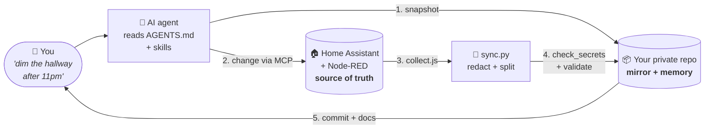

<div align="center">

# 🏠🤖 HA Agent Kit

### Give your Home Assistant an AI co-pilot that explains its work, never leaks a secret, and can undo anything.

[](https://github.com/deanlongstaff/ha-agent-kit/generate)
&nbsp;
[](https://www.home-assistant.io)
&nbsp;
[](https://claude.com/claude-code)
&nbsp;
[](LICENSE)

**A template repo that turns "ask an AI to fiddle with my smart home" into a proper,<br>
reviewable, version-controlled workflow — for brand-new installs and ten-year-old ones.**

[Quick start](#-quick-start) · [New install](docs/guides/new-install.md) · [Existing install](docs/guides/existing-install.md) · [MCP setup](docs/guides/mcp-setup.md) · [Security](SECURITY.md)

</div>

---

## 🤔 Why?

AI agents are *great* at Home Assistant now. They can write automations, build dashboards,
read traces and untangle Node-RED. But point one at your live house and you quickly hit:

- 😬 **"What did it just change?"** — edits vanish into the UI with no record.
- 🔙 **"How do I undo that?"** — there's no diff, no history, no rollback.
- 🔑 **"Did it just paste my token into a file?"** — config is full of secrets.
- 🧠 **"Why is it like this?"** — next week, neither you nor the AI remembers.
- 🍝 **"What *is* this automation?"** — 120 lines of Jinja where three native triggers would do.

**HA Agent Kit** fixes all of that with a simple idea:

> Your live Home Assistant stays the source of truth. **This repo becomes its mirror and its
> memory** — every dashboard, automation, helper and Node-RED flow exported as readable
> files, scrubbed of secrets, documented, and committed after *every* change the AI makes.

## ✨ What you get

| | |
|---|---|
| 🔁 **The loop** | Snapshot → change → export → review → commit. Every AI change is one `git revert` away from undone. |
| 📸 **A full export** | Dashboards, automations, scripts, scenes, helpers, areas, devices, entities, integrations, add-ons and Node-RED flows — as clean YAML/JSON, one file per thing. Works on every install type. |
| 🛡️ **Four layers of secret protection** | Redaction at export, your personal denylist, a pre-commit hook and CI with gitleaks. Tokens, keys, e-mails, phone numbers, coordinates, MCP URLs: blocked. |
| 📜 **Agent rules that work** | An [`AGENTS.md`](AGENTS.md) battle-tested on a real, busy house: confirm before deleting, native-first, change only what was asked, never touch credentials. |
| 🧩 **Skills, pre-installed** | Onboarding and sync skills, plus pinned community skills for HA best practices, Node-RED and Bubble Card dashboards. |
| 🧭 **Guided onboarding** | Say *"set up this repo"* and the agent interviews you, connects MCP, protects your privacy and makes the first commit. |
| 🩺 **A doctor** | `python3 tools/doctor.py` checks your hooks, denylist, repo visibility, skills and exports. |
| 📚 **Docs that write themselves** | Generated reference pages for dashboards, automations, helpers, areas and flows, plus templates for the human *why*. |

## 🔁 How it works



The agent never edits files in the repo to change your house. It changes the **live
system** through proper APIs (validated, with HA's own checks), then **exports** the result.
So the repo can never drift into a fantasy version of your home.

## 🚀 Quick start

You need: Home Assistant, Python 3.9+, git, and an AI coding agent
([Claude Code](https://claude.com/claude-code) recommended — terminal, desktop app or IDE).

**1. Make your own private copy**

Click **[Use this template](https://github.com/deanlongstaff/ha-agent-kit/generate)** →
choose **Private** (🔒 important — [here's why](SECURITY.md#4-keep-your-home-repo-private)) → clone it.

```bash
git clone https://github.com/<you>/my-home.git && cd my-home
python3 -m pip install pyyaml
git config core.hooksPath .githooks
cp .secrets-denylist.example .secrets-denylist
python3 tools/doctor.py
```

**2. Connect your agent to Home Assistant** — install [ha-mcp](https://github.com/homeassistant-ai/ha-mcp)
and add it at user scope ([full guide](docs/guides/mcp-setup.md)):

```bash
claude mcp add --transport http --scope user home-assistant "http://<ha-ip>:9584/private_<secret>/readonly"
```

(`/readonly` = look but don't touch. Drop it when you're ready.)

**3. Say hello**

```bash
claude
```

> **Set up this repo for my existing Home Assistant.**
>
> *or*
>
> **Set up this repo for my new Home Assistant.**

The onboarding skill takes it from there. ☕

## 🛤️ Pick your path

<table>
<tr>
<td width="50%" valign="top">

### 🌱 Path A — New install

Start clean and *stay* clean. The agent helps you lay foundations in the right order:
areas and floors, naming conventions, encrypted off-site backups, presence, modes as
helpers, then your first automations and dashboard — every step a reviewed commit.

**→ [New install guide](docs/guides/new-install.md)**

</td>
<td width="50%" valign="top">

### 🏚️ Path B — Existing install

Years of automations? Perfect. Export everything (read-only), review it for privacy,
commit a snapshot, let the agent write your house docs, then get a **best-practice audit**
of what to improve. Fix things one commit at a time.

**→ [Existing install guide](docs/guides/existing-install.md)**

</td>
</tr>
</table>

## 💬 Things you can ask

```text
"Give me a tour of my setup — rooms, busiest integrations, most-run automations."
"The porch light didn't come on last night. Check the traces and tell me why."
"When the washing machine finishes, tell whoever's home. Nag again after 30 min."
"Find automations using device_id and convert them to entity_id, one commit each."
"Add an open-windows card to the Home dashboard. Change nothing else."
"List everything exposed to Assist that can unlock, open or disarm something."
"What changed this week, and why?"
```

More in **[prompts.md](docs/guides/prompts.md)**.

## 🛡️ Security, in one screen

| | |
|---|---|
| 🏠 **Agent access stays local** | ha-mcp listens on your LAN only, as a dedicated local-only admin user. No admin endpoint on the internet. |
| 📱 **Phone AI gets the minimum** | Claude on your phone uses HA's built-in MCP Server's device-control endpoint as a **non-admin** user — it can only reach what you expose to Assist. |
| 🔑 **The agent never handles secrets** | You log in; you type passwords and codes. MCP URLs live in user config, never the repo. |
| 🧹 **Nothing sensitive reaches git** | Redaction → denylist → pre-commit hook → CI + gitleaks over full history. |
| 🔒 **Your repo stays private** | The kit is public; your home isn't. `doctor.py` shouts if your remote is public. |
| ✋ **Destructive = ask first** | Deletes, restarts, restores and updates always need your OK. |

Read the full model in **[SECURITY.md](SECURITY.md)**.

## 🗂️ What's in the box

```
AGENTS.md                 the rules every agent follows (CLAUDE.md points here)
SECURITY.md               the security model
docs/
  home.md                 YOUR house: install, URLs, people, keep-list (filled by onboarding)
  conventions.md          naming + automation conventions (sensible defaults)
  architecture.md …       templates for the human "why"
  guides/                 new install · existing install · MCP setup · prompt ideas
  reference/              generated on every sync
.claude/skills/
  ha-onboard/             first-run setup interview
  ha-sync/                collect → sync → check → docs → commit
  home-assistant-best-practices/ node-red/ ha-bubble-dashboard/   pinned community skills
tools/
  collect.js              read-only exporter — run in a browser tab (no token)
  collect-cli.mjs         …or from the terminal with a token
  sync.py  redact.py      turn the export into clean, redacted files
  check_secrets.py        secret + personal-data scanner (hook + CI)
  validate.py             YAML/JSON/Node-RED wiring checks + function-node lint
  doctor.py               setup checker
  update_kit.sh           pull kit updates without touching your home's files
```

After your first sync you'll also have `homeassistant/` (dashboards, automations, scripts,
scenes, helpers, inventory) and, if you use it, `node-red/` (one file per tab).

## 🧰 Requirements and compatibility

| | |
|---|---|
| Home Assistant | 2026.8+ recommended (ha-mcp integration). HA OS / Supervised get the full export (add-ons, Node-RED, config files); Container / Core get everything else. |
| Agent | Claude Code (skills auto-load). Other agents that read `AGENTS.md` (Codex, Cursor, Gemini CLI, Copilot…) can follow the rules and use the tools. |
| Local tools | Python 3.9+ with PyYAML, git. Node 22+ only for the terminal collector. |
| Optional | Node-RED add-on, Studio Code Server add-on (for raw config files), `gh` CLI. |

## 🔄 Updating the kit

Your repo is yours, but the kit keeps improving. Pull new tools, skills and rules without
touching your house's files:

```bash
tools/update_kit.sh
git diff                       # review
git commit -am "chore(repo): update HA Agent Kit"
```

## ❓ FAQ

<details>
<summary><b>Does the AI edit my YAML files directly?</b></summary>

No. Changes go to the live system through Home Assistant's APIs (via MCP or the browser),
where HA validates them. The repo is then regenerated from the live system. Hand-editing
files in `homeassistant/` does nothing — the next sync overwrites them.
</details>

<details>
<summary><b>Is this a backup?</b></summary>

It's a *history*, not a backup. It has no database, no `.storage`, no secrets. Keep Home
Assistant's own encrypted, off-site backups too — the agent can help you set them up.
</details>

<details>
<summary><b>I don't use Node-RED. / I only use Node-RED.</b></summary>

Both are fine. Without Node-RED the `node-red/` parts are simply skipped. With it, every
tab is exported as an importable file, and the agent deploys only the nodes it changed.
</details>

<details>
<summary><b>Can I use this without MCP?</b></summary>

Yes. The agent can work through a browser tab where you're logged in, or hand you the exact
change to apply. Exports work from the browser (`tools/collect.js`) or the terminal
(`tools/collect-cli.mjs`).
</details>

<details>
<summary><b>Will it work with ChatGPT / Codex / Cursor / Gemini?</b></summary>

`AGENTS.md` is a cross-tool standard, and the tools are plain Python and JavaScript. It's
built and tested with Claude Code, whose skills load automatically; other agents can read
the skill files when pointed at them.
</details>

<details>
<summary><b>What if Home Assistant changes something in a release?</b></summary>

HA ships monthly. The rules tell the agent to compare versions, read the release notes and
*adapt the docs and tools* rather than work around surprises.
</details>

## 🙏 Credits

Standing on the shoulders of:

- [Home Assistant](https://www.home-assistant.io) and its wonderful community
- [ha-mcp](https://github.com/homeassistant-ai/ha-mcp) and [homeassistant-ai/skills](https://github.com/homeassistant-ai/skills)
- [aurora-smart-home](https://github.com/tonylofgren/aurora-smart-home) (Node-RED skill)
- [HA_Bubble_Skill](https://github.com/johnnyh1975/HA_Bubble_Skill) (Bubble Card skill)
- [gitleaks](https://github.com/gitleaks/gitleaks)

Born from a real, busy smart home where an AI agent has been making changes every day —
and every one of them is in git.

## 🤝 Contributing

Issues and PRs welcome — see [CONTRIBUTING.md](CONTRIBUTING.md). The golden rule applies to
contributions too: **nothing from your own home** in issues or PRs.

## 📄 License

[MIT](LICENSE). Vendored skills keep their own MIT licences.

<div align="center">

**If this made your smart home a little less scary to hand to an AI, give it a ⭐**

</div>
