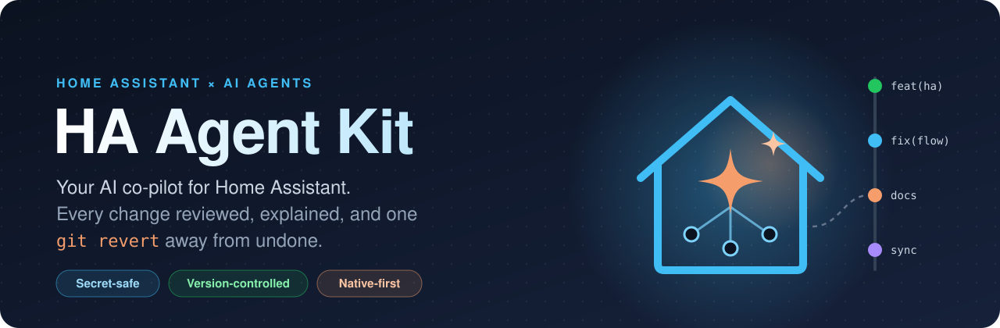
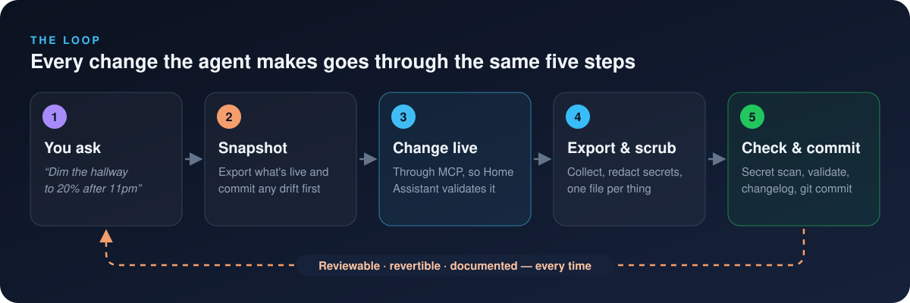
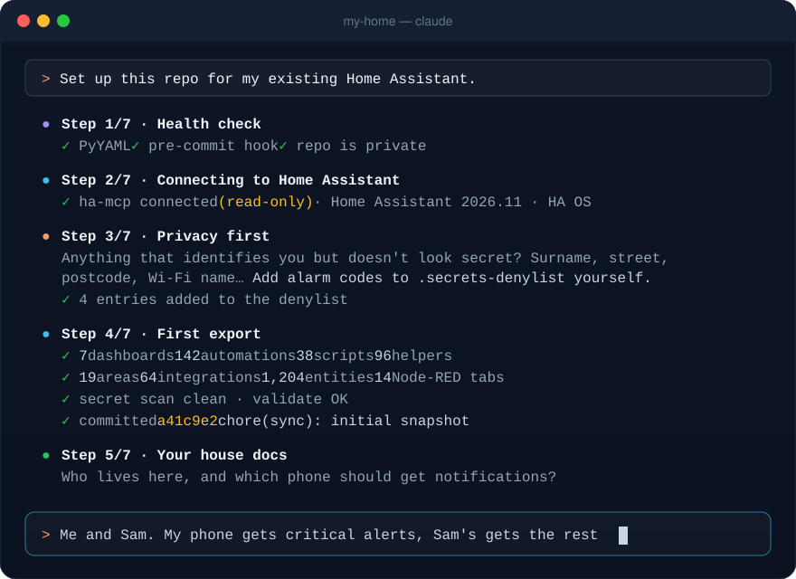
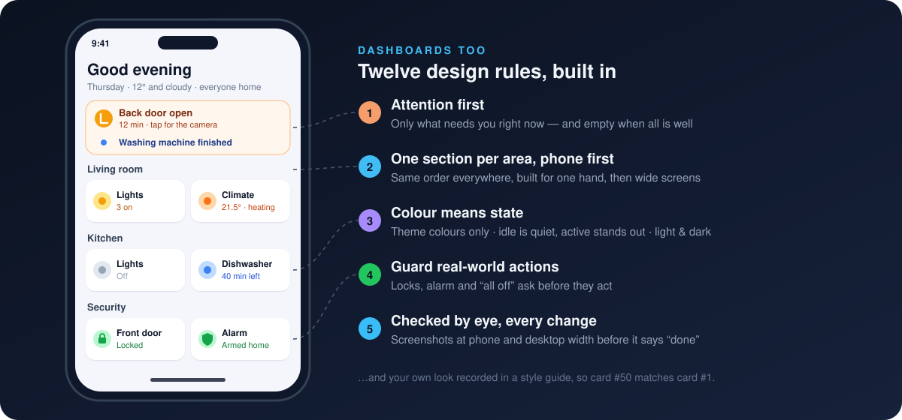
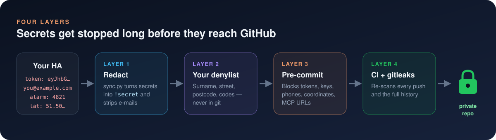

<p align="center">
  
</p>

<p align="center">
  <a href="https://github.com/deanlongstaff/ha-agent-kit/generate"></a>
  <a href="https://www.home-assistant.io"></a>
  <a href="https://claude.com/claude-code"></a>
  <a href="LICENSE"></a>
</p>

<p align="center">
  <b>Let an AI agent build and look after your Home Assistant — safely.</b><br>
  Every change it makes is exported, scrubbed of secrets, explained and committed to <i>your</i> private git repo.<br>
  For brand-new installs and ten-year-old ones.
</p>

<p align="center">
  <a href="#-quick-start"><b>Quick start</b></a> ·
  <a href="docs/guides/new-install.md">New install</a> ·
  <a href="docs/guides/existing-install.md">Existing install</a> ·
  <a href="docs/guides/mcp-setup.md">MCP setup</a> ·
  <a href="SECURITY.md">Security</a> ·
  <a href="docs/guides/prompts.md">Prompt ideas</a>
</p>

---

## 🤔 Why?

AI agents are genuinely good at Home Assistant now — automations, dashboards, traces,
Node-RED. But point one at the house you live in and the same questions come up:

| 😬 Without the kit | 😌 With the kit |
|---|---|
| *"What did it just change?"* | Every change is a commit with a readable diff |
| *"How do I undo that?"* | `git revert` — or just *"undo yesterday's hallway change"* |
| *"Did it just put my token in a file?"* | Four layers stop secrets long before GitHub |
| *"Why is it set up like this?"* | A changelog and decision log the agent reads every session |
| *"What is this 120-line template?"* | Native-first rules: triggers, conditions and helpers a human can read |
| *"It deleted my Christmas lights automation!"* | Confirm-before-delete, plus a keep-list of things that only *look* dead |
| *"My dashboard is a wall of 200 entities."* | Twelve design rules, your own style guide, and a screenshot check on every change |
| *"An update broke everything."* | Every sync records versions; the agent reads the changelogs before *and* after you update |

**The idea in one line:** your live Home Assistant stays the source of truth, and this repo
becomes its **mirror and its memory**.

## 🔁 How it works

<p align="center">
  
</p>

The agent never edits files in the repo to change your house. It changes the **live system**
through Home Assistant's own APIs (so HA validates everything), then **exports** the result.
The repo can't drift into a fantasy version of your home.

## 🚀 Quick start

You need: Home Assistant, Python 3.9+, git, and an AI coding agent
([Claude Code](https://claude.com/claude-code) recommended — terminal, desktop app or IDE).

**1. Make your own private copy**

Click **[Use this template](https://github.com/deanlongstaff/ha-agent-kit/generate)** →
choose **Private** (🔒 important — [here's why](SECURITY.md#4-keep-your-home-repo-private)) → clone it.

```bash
git clone https://github.com/<you>/my-home.git && cd my-home
python3 -m pip install pyyaml
git config core.hooksPath .githooks
cp .secrets-denylist.example .secrets-denylist
python3 tools/doctor.py
```

**2. Connect your agent to Home Assistant** — install [ha-mcp](https://github.com/homeassistant-ai/ha-mcp)
and add it at user scope ([full guide](docs/guides/mcp-setup.md)):

```bash
claude mcp add --transport http --scope user home-assistant "http://<ha-ip>:9584/private_<secret>/readonly"
```

(`/readonly` = look but don't touch. Drop it when you're ready.)

**3. Say hello**

```bash
claude
```

> **Set up this repo for my existing Home Assistant.**
>
> *or*
>
> **Set up this repo for my new Home Assistant.**

The onboarding skill takes it from there. ☕ Here's roughly what that first session looks like:

<p align="center">
  
</p>

## 🛤️ Pick your path

<table>
<tr>
<td width="50%" valign="top">

### 🌱 Path A — New install

Start clean and *stay* clean. The agent helps you lay foundations in the right order:
areas and floors, naming conventions, encrypted off-site backups, presence, modes as
helpers, then your first automations and dashboard — every step a reviewed commit.

**→ [New install guide](docs/guides/new-install.md)**

</td>
<td width="50%" valign="top">

### 🏚️ Path B — Existing install

Years of automations? Perfect. Export everything (read-only), review it for privacy,
commit a snapshot, let the agent write your house docs, then get a **best-practice audit**
of what to improve. Fix things one commit at a time.

**→ [Existing install guide](docs/guides/existing-install.md)**

</td>
</tr>
</table>

## 🧠 Built-in automations, Node-RED, or both

Use whichever you love. The kit treats both as first-class, and onboarding asks which you
prefer so the agent builds new things in the right place.

| | 🏠 Home Assistant automations | 🔴 Node-RED |
|---|---|---|
| **Exported as** | One YAML file per automation, script and scene | One importable JSON file per tab |
| **Generated reference** | Alias, mode, triggers and description of every automation | Every tab with node counts |
| **House rules** | Description says why · `entity_id` not `device_id` · current syntax · short templates | Native nodes first · small, single-job function nodes |
| **Checked on every commit** | `automation_lint.py` | `function_lint.py` + wiring check |
| **Existing setups** | Today's automations are grandfathered; rules apply to new work | Same for today's function nodes |
| **Guide** | [automations.md](docs/automations.md) | [node-red.md](docs/node-red.md) |

Not sure? [Here's how to choose](docs/automations.md#ha-automations-or-node-red). Using
both? Write the rule for which goes where in `docs/home.md`, and the agent sticks to it.

## 🎨 Dashboards, not just automations

The agent is just as handy with your UI. It designs to a set of
[design rules](docs/dashboards.md#design-rules), records *your* look in a
[style guide](docs/style-guide.md) so card #50 matches card #1, and **looks at its own work**:
screenshots at phone and desktop width before it calls anything done.

<p align="center">
  
</p>

Native cards first (tile, heading, badges, area, thermostat), with an optional skill for
[Bubble Card](https://github.com/Clooos/Bubble-Card) if you like a more styled look. Existing
dashboards? Onboarding drafts your style guide from what you already have.

## 🔄 Update-aware

Home Assistant ships monthly, and your integrations, add-ons, custom cards and device
firmware update constantly. Every sync records what's installed
(`inventory/versions.yaml`), so the diff shows exactly what changed. Then:

- **Before you update:** *"Is it safe to install the pending updates?"* — the agent reads
  every changelog in between, greps your setup for what each breaking change touches, and
  rates each update *safe / needs a change first / read yourself*.
- **After you update:** it spots what changed, checks Repairs, logs and unavailable
  entities, and fixes or flags the fallout — updating its own docs and tools rather than
  working around surprises.

## ✨ What's included

| | |
|---|---|
| 🔁 **The loop** | Snapshot → change → export → review → commit. Every AI change is one `git revert` away from undone. |
| 📸 **A complete export** | Dashboards, automations, scripts, scenes, helpers, areas, devices, entities, integrations, add-ons and Node-RED flows — clean YAML/JSON, one file per thing. HA OS, Supervised, Container and Core. Old YAML automations it can't read are listed, not silently skipped. |
| 🎨 **Dashboard design rules** | Attention first, phone first, native cards, colour that means something, guarded actions — plus your own style guide and a screenshot check. |
| 🔄 **Update-aware** | Versions of HA, custom integrations, add-ons, cards and firmware in every sync; changelogs read before and after updates. |
| ✅ **Quality checks on every commit** | HA automations need a *why*, use `entity_id` and current syntax; Node-RED function nodes stay small. Existing work is grandfathered. |
| 🛡️ **Four layers of secret protection** | Redaction, your personal denylist, a pre-commit hook, and CI with gitleaks. |
| 📜 **Agent rules that hold up** | An [`AGENTS.md`](AGENTS.md) refined on a real, busy house: confirm before deleting, native-first, change only what was asked, never touch credentials. |
| 🧭 **Guided onboarding** | Say *"set up this repo"* and the agent interviews you, connects, protects your privacy and makes the first commit. |
| 🧩 **Skills, ready to go** | `ha-onboard` and `ha-sync`, plus pinned community skills for HA best practices, Node-RED and Bubble Card dashboards. |
| 🩺 **A doctor** | `python3 tools/doctor.py` checks hooks, denylist, repo visibility, skills and exports in one go. |
| 📚 **Docs that keep up** | Reference pages regenerated on every sync, plus templates for the human *why*: house profile, conventions, decisions, known issues. |

## 💬 Things you can ask

```text
"Give me a tour of my setup — rooms, busiest integrations, most-run automations."
"The porch light didn't come on last night. Check the traces and tell me why."
"When the washing machine finishes, tell whoever's home. Nag again after 30 min."
"Find automations using device_id and convert them to entity_id, one commit each."
"Add an open-windows card to the Home dashboard. Change nothing else."
"Redesign the Living room section to follow the design rules — show me before and after."
"Is it safe to install the pending updates? Check every changelog for breaking changes."
"List everything exposed to Assist that can unlock, open or disarm something."
"What changed this week, and why?"
```

More in **[prompts.md](docs/guides/prompts.md)**.

## 🛡️ Security, in one screen

<p align="center">
  
</p>

| | |
|---|---|
| 🏠 **Agent access stays local** | ha-mcp listens on your LAN only, as a dedicated local-only admin user. No admin endpoint on the internet. |
| 📱 **Phone AI gets the minimum** | Claude on your phone uses HA's built-in MCP Server's device-control endpoint as a **non-admin** user — it can only reach what you expose to Assist. |
| 🔑 **The agent never handles secrets** | You log in; you type passwords and codes. MCP URLs live in user config, never the repo. |
| 🧹 **Nothing sensitive reaches git** | Redaction → denylist → pre-commit hook → CI + gitleaks over full history. |
| 🔒 **Your repo stays private** | The kit is public; your home isn't. `doctor.py` shouts if your remote is public. |
| ✋ **Destructive = ask first** | Deletes, restarts, restores and updates always need your OK. |

Read the full model in **[SECURITY.md](SECURITY.md)**.

## 🗂️ What's in the box

```
AGENTS.md                 the rules every agent follows (CLAUDE.md points here)
SECURITY.md               the security model
docs/
  home.md                 YOUR house: install, URLs, people, keep-list (filled by onboarding)
  conventions.md          naming, helper and notification conventions
  automations.md          HA automation house rules; node-red.md for flows
  dashboards.md           dashboard design rules + workflow; style-guide.md for your look
  architecture.md …       templates for the human "why"
  guides/                 new install · existing install · MCP setup · prompt ideas
  reference/              generated on every sync
.claude/skills/
  ha-onboard/             first-run setup interview
  ha-sync/                collect → sync → check → docs → commit
  home-assistant-best-practices/ node-red/ ha-bubble-dashboard/   pinned community skills
tools/
  collect.js              read-only exporter — run in a browser tab (no token)
  collect-cli.mjs         …or from the terminal with a token
  sync.py  redact.py      turn the export into clean, redacted files
  check_secrets.py        secret + personal-data scanner (hook + CI)
  validate.py             YAML/JSON/Node-RED wiring checks, runs both linters
  automation_lint.py      house rules for HA automations and scripts
  function_lint.py        house rules for Node-RED function nodes
  doctor.py               setup checker
  update_kit.sh           pull kit updates without touching your home's files
assets/                   the images in this README (onboarding removes them from your copy)
```

After your first sync you'll also have `homeassistant/` (dashboards, automations, scripts,
scenes, helpers, inventory) and, if you use it, `node-red/` (one file per tab).

## 🧰 Requirements and compatibility

| | |
|---|---|
| Home Assistant | 2026.8+ recommended (ha-mcp integration). HA OS / Supervised get the full export (add-ons, Node-RED, config files); Container / Core get everything else. |
| Agent | Claude Code (skills auto-load). Other agents that read `AGENTS.md` (Codex, Cursor, Gemini CLI, Copilot…) can follow the rules and use the tools. |
| Local tools | Python 3.9+ with PyYAML, git. Node 22+ only for the terminal collector. |
| Optional | Node-RED add-on, Studio Code Server add-on (for raw config files), `gh` CLI. |

## 🔄 Updating the kit

Your repo is yours, but the kit keeps improving. Pull new tools, skills and rules without
touching your house's files:

```bash
tools/update_kit.sh
git diff                       # review
git commit -am "chore(repo): update HA Agent Kit"
```

## ❓ FAQ

<details>
<summary><b>Does the AI edit my YAML files directly?</b></summary>

No. Changes go to the live system through Home Assistant's APIs (via MCP or the browser),
where HA validates them. The repo is then regenerated from the live system. Hand-editing
files in `homeassistant/` does nothing — the next sync overwrites them.
</details>

<details>
<summary><b>Is this a backup?</b></summary>

It's a *history*, not a backup. It has no database, no `.storage`, no secrets. Keep Home
Assistant's own encrypted, off-site backups too — the agent can help you set them up.
</details>

<details>
<summary><b>I don't use Node-RED. / I only use Node-RED.</b></summary>

Both are fine — see [Built-in automations, Node-RED, or both](#-built-in-automations-node-red-or-both).
Without Node-RED the `node-red/` parts are skipped and the agent never suggests it. With
it, every tab is an importable file and the agent deploys only the nodes it changed.
</details>

<details>
<summary><b>Can I use this without MCP?</b></summary>

Yes. The agent can work through a browser tab where you're logged in, or hand you the exact
change to apply. Exports work from the browser (`tools/collect.js`) or the terminal
(`tools/collect-cli.mjs`).
</details>

<details>
<summary><b>Will it work with ChatGPT / Codex / Cursor / Gemini?</b></summary>

`AGENTS.md` is a cross-tool standard, and the tools are plain Python and JavaScript. It's
built and tested with Claude Code, whose skills load automatically; other agents can read
the skill files when pointed at them.
</details>

<details>
<summary><b>What if Home Assistant changes something in a release?</b></summary>

HA ships monthly. The rules tell the agent to compare versions, read the release notes and
*adapt the docs and tools* rather than work around surprises.
</details>

## 🙏 Credits

Standing on the shoulders of:

- [Home Assistant](https://www.home-assistant.io) and its wonderful community
- [ha-mcp](https://github.com/homeassistant-ai/ha-mcp) and [homeassistant-ai/skills](https://github.com/homeassistant-ai/skills)
- [aurora-smart-home](https://github.com/tonylofgren/aurora-smart-home) (Node-RED skill)
- [HA_Bubble_Skill](https://github.com/johnnyh1975/HA_Bubble_Skill) (Bubble Card skill)
- [gitleaks](https://github.com/gitleaks/gitleaks)

Born from a real, busy smart home where an AI agent has been making changes every day —
and every one of them is in git.

## 🤝 Contributing

Issues and PRs welcome — see [CONTRIBUTING.md](CONTRIBUTING.md). The golden rule applies to
contributions too: **nothing from your own home** in issues or PRs.

## 📄 License

[MIT](LICENSE). Vendored skills keep their own MIT licences.

<div align="center">

**If this made your smart home a little less scary to hand to an AI, give it a ⭐**

</div>
